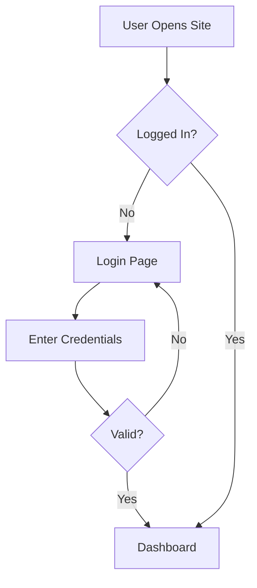
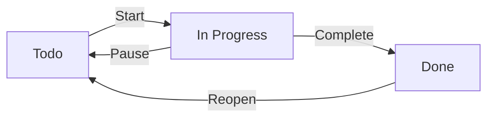
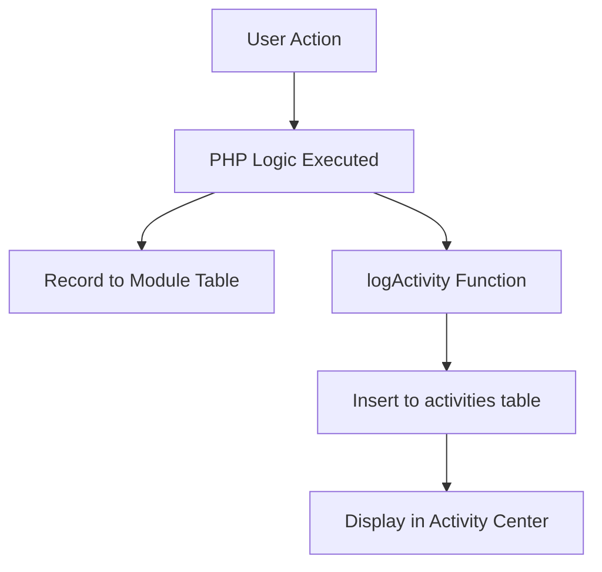
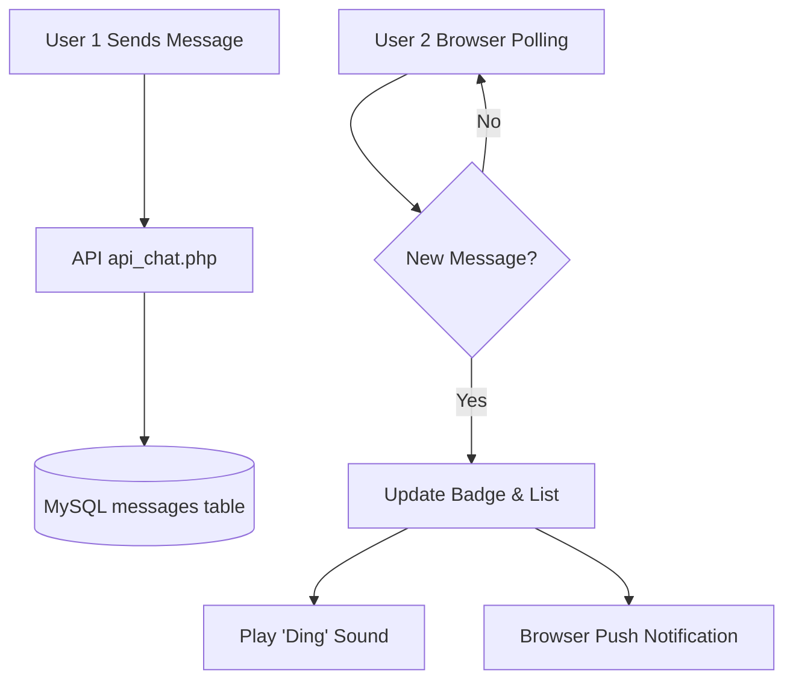
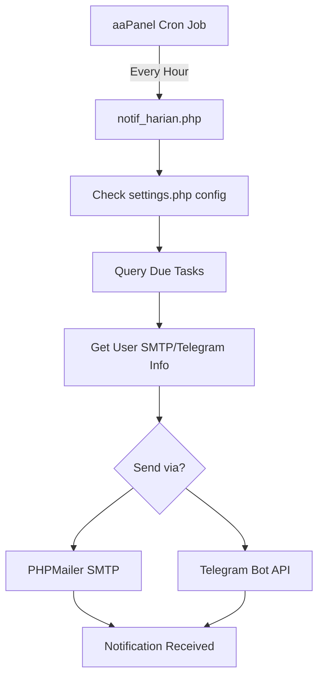
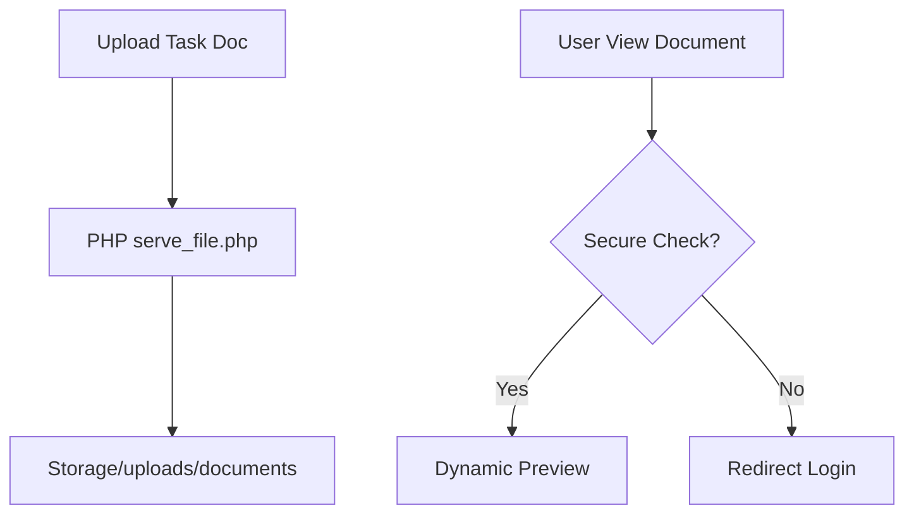

# 🔄 TaskFlow Pro Logic Flowcharts

These diagrams illustrate the core logic of the application.

## 🔑 Authentication & Access Flow

## 📋 Kanban & Task Status Flow

## 📈 Activity Logging System

## 💬 Real-Time Chat & Sound Notification Flow

## 📧 Multi-Channel Daily Notification Flow

## 📂 Document Management & Preview Flow

